# Laboratory Work No. 6: Anomaly Detection in Data Using Machine Learning Algorithms

**Course:** Artificial Intelligence in Cybersecurity  
**Student:** `<STUDENT_NAME>`  
**Group:** `<GROUP>`  
**Date:** 02.11.2026  
**Individual topic / variant:**  — self-improvement YouTube videos dataset (from Labs 2–3)

---

## 1. Objective

To study unsupervised anomaly detection, implement Isolation Forest and Local Outlier Factor (LOF) on the individual dataset, visualize the detected anomalies and compare the results of the two algorithms.

## 2. Dataset Description

The dataset `clean_dataset.csv` was collected in Lab 2 and cleaned in Lab 3. Each row is one YouTube video from the self-improvement / motivation niche.

| Column | Type | Meaning |
|---|---|---|
| `id` | int | Row identifier |
| `video_url` | str | Link to the video |
| `video_title` | str | Title of the video |
| `title_length` | int | Number of characters in the title |
| `contains_number` | bool | Title contains a digit |
| `day_since_published` | int | Age of the video in days |
| `views_count` | int | Number of views |
| `has_uppercase_words` | bool | Title contains fully uppercase words |
| `label` | bool | Manual binary classification target from Lab 2 |

**Selected features** (continuous numeric columns):

- `views_count` — popularity of the video; unusually high or low values may indicate viral content, bought views or a dead video.
- `day_since_published` — age of the video; together with views it describes how activity accumulates over time.
- `title_length` — length of the title; very short or very long titles are atypical for the niche.

Boolean columns were not used: binary 0/1 values produce many identical distances, which distorts the density estimates of LOF. `label` was deliberately excluded because the method is unsupervised.

## 3. Dataset Size and Missing-Value Check

- **Size:** 100 rows × 9 columns
- **Features:** `views_count`, `day_since_published`, `title_length`
- **Missing values:** `{'views_count': 0, 'day_since_published': 0, 'title_length': 0}` — validation passed
- All selected columns were successfully converted with `pd.to_numeric(errors="raise")`

| Statistic | views_count | day_since_published | title_length |
|---|---|---|---|
| mean | 718 750.24 | 296.57 | 45.86 |
| std | 1 752 033.09 | 386.00 | 14.04 |
| min | 182 | 1 | 11 |
| 25% | 25 365.5 | 57.75 | 36 |
| 50% | 100 066 | 169.5 | 44.5 |
| 75% | 574 412.5 | 331.25 | 57 |
| max | 11 459 513 | 1 945 | 82 |

The scales differ by five orders of magnitude, so standardization (Task 3) is required.

## 4. Code and Execution Screenshots

Full source code: `lab_6.py`. Screenshots of execution are in `screenshots/`.

### Task 1. Load the dataset
```python
df = pd.read_csv("clean_dataset.csv")
print(f"Shape: {df.shape}")
print(df.drop(columns=["video_url"]).head())
print(df.dtypes)
```
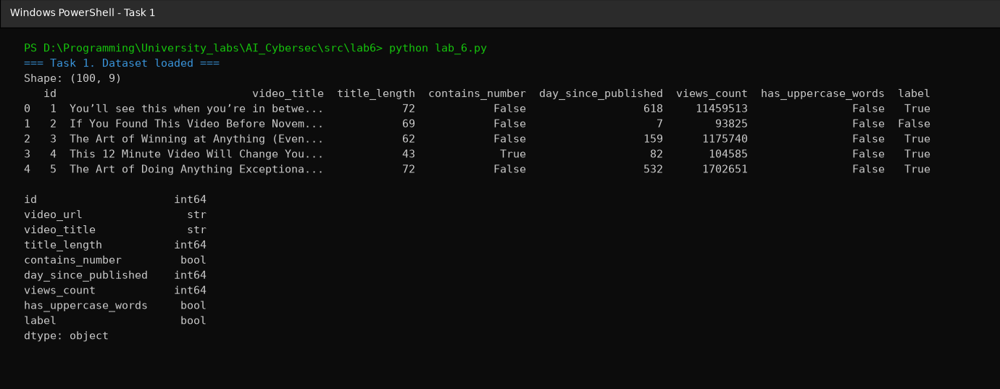

### Task 2. Select features and validate data
```python
features = ["views_count", "day_since_published", "title_length"]
X = df[features].copy()
X = X.apply(pd.to_numeric, errors="raise")
if X.isna().any().any():
    raise ValueError("Selected features contain missing values")
if len(X) < 10:
    raise ValueError("At least 10 rows are required")
print(X.describe().round(2))
```
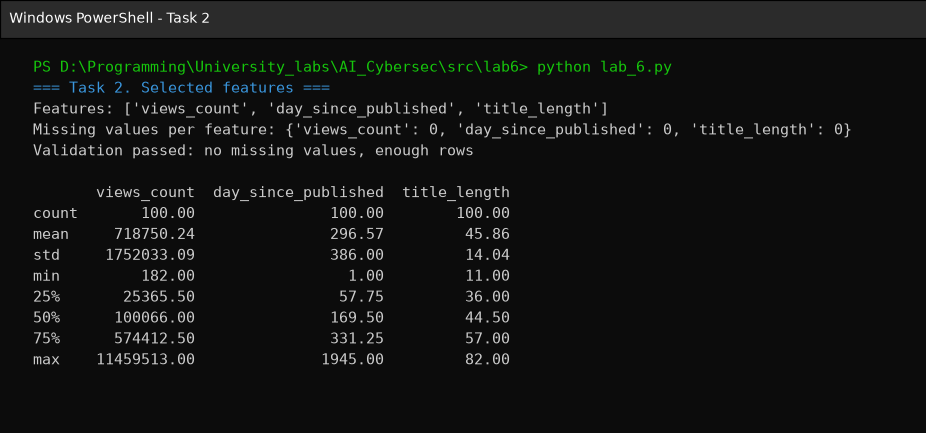

### Task 3. Standardize the features
```python
scaler = StandardScaler()
X_scaled = scaler.fit_transform(X)
print("Scaled data shape:", X_scaled.shape)
```
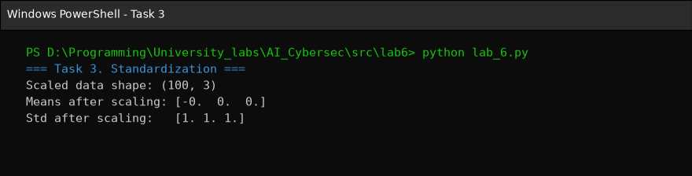

### Task 4. Isolation Forest
```python
iso = IsolationForest(contamination=0.10, random_state=42)
iso_pred = iso.fit_predict(X_scaled)
df["IF_anomaly"] = (iso_pred == -1).astype(int)
df["IF_score"] = -iso.score_samples(X_scaled)
print(df["IF_anomaly"].value_counts())
```
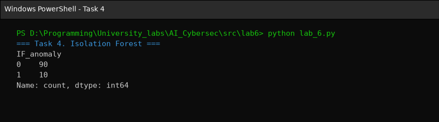

### Task 5. Local Outlier Factor
```python
lof = LocalOutlierFactor(n_neighbors=min(20, len(X) - 1), contamination=0.10)
lof_pred = lof.fit_predict(X_scaled)
df["LOF_anomaly"] = (lof_pred == -1).astype(int)
df["LOF_score"] = -lof.negative_outlier_factor_
print(df["LOF_anomaly"].value_counts())
```
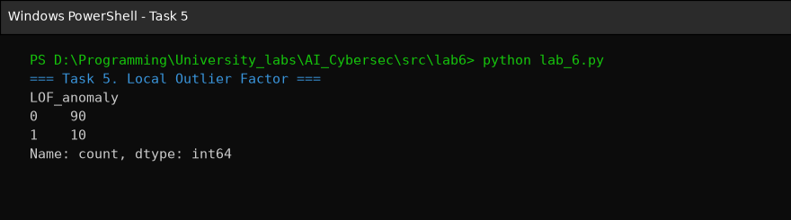

### Task 6. Compare the two algorithms
```python
summary = pd.DataFrame({
    "Algorithm": ["Isolation Forest", "Local Outlier Factor"],
    "Anomalies": [df["IF_anomaly"].sum(), df["LOF_anomaly"].sum()],
    "Anomaly rate": [df["IF_anomaly"].mean(), df["LOF_anomaly"].mean()],
})
print(summary)
print("Agreement (ARI):", adjusted_rand_score(df["IF_anomaly"], df["LOF_anomaly"]))
```
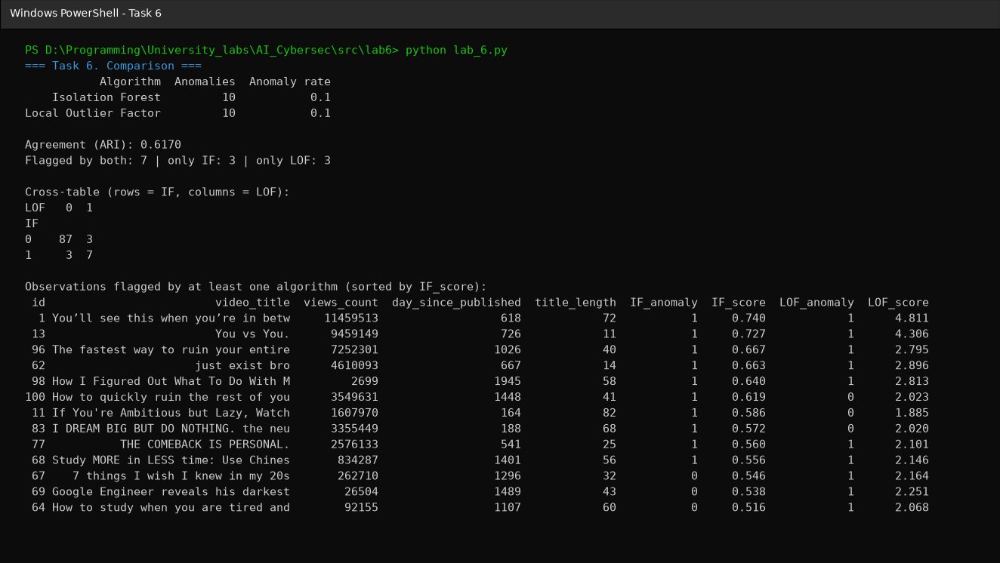

### Task 7. Visualize detected anomalies
```python
plt.figure(figsize=(7, 5))
plt.scatter(X.iloc[:, 0], X.iloc[:, 1], c=df["IF_anomaly"], cmap="coolwarm", s=35)
plt.xlabel(features[0]); plt.ylabel(features[1])
plt.title("Isolation Forest: anomaly flags")
plt.colorbar(label="Anomaly (1 = yes)")
plt.savefig("if_anomalies.png")
# the same for LOF -> lof_anomalies.png
```
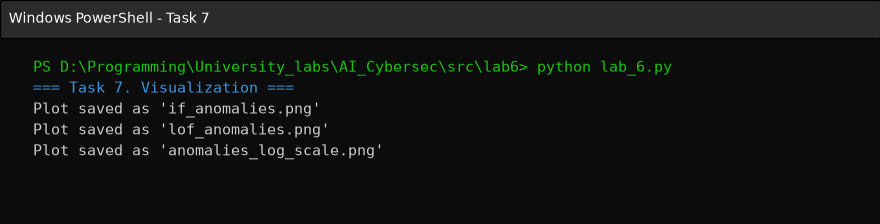

### Task 8. Check the meaning of `label`
```python
if "label" in df.columns:
    print("The existing label is NOT automatically an anomaly label.")
    print("Evaluate against label only if its meaning is verified.")
# classification_report / confusion_matrix left commented out (see Section 9)
```
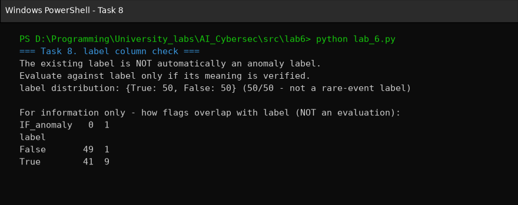

### Task 9. Save results
```python
df.to_csv("anomaly_results.csv", index=False)
```
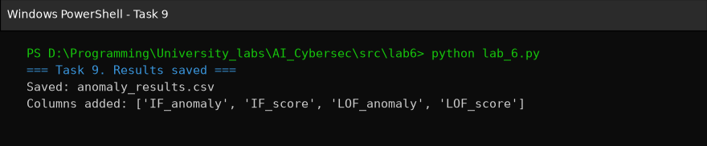

## 5. Isolation Forest Results

- **Anomalies found:** 10 of 100
- **Proportion:** 0.10 (10%)
- Anomalous video ids (by decreasing `IF_score`): 1, 13, 96, 62, 98, 100, 11, 83, 77, 68

## 6. LOF Results

- **Anomalies found:** 10 of 100
- **Proportion:** 0.10 (10%)
- Anomalous video ids: 1, 13, 96, 62, 98, 77, 68, 67, 69, 64

## 7. Comparison Table, ARI and Plots

| Algorithm | Anomalies | Anomaly rate |
|---|---|---|
| Isolation Forest | 10 | 0.10 |
| Local Outlier Factor | 10 | 0.10 |

**Agreement (ARI): 0.6170**

| | LOF = 0 | LOF = 1 |
|---|---|---|
| **IF = 0** | 87 | 3 |
| **IF = 1** | 3 | 7 |

- Flagged by both algorithms: **7** (ids 1, 13, 96, 62, 98, 77, 68)
- Only Isolation Forest: **3** (ids 100, 11, 83)
- Only LOF: **3** (ids 67, 69, 64)

| id | views_count | day_since_published | title_length | IF | IF_score | LOF | LOF_score |
|---|---|---|---|---|---|---|---|
| 1 | 11 459 513 | 618 | 72 | 1 | 0.740 | 1 | 4.811 |
| 13 | 9 459 149 | 726 | 11 | 1 | 0.727 | 1 | 4.306 |
| 96 | 7 252 301 | 1026 | 40 | 1 | 0.667 | 1 | 2.795 |
| 62 | 4 610 093 | 667 | 14 | 1 | 0.663 | 1 | 2.896 |
| 98 | 2 699 | 1945 | 58 | 1 | 0.640 | 1 | 2.813 |
| 100 | 3 549 631 | 1448 | 41 | 1 | 0.619 | 0 | 2.023 |
| 11 | 1 607 970 | 164 | 82 | 1 | 0.586 | 0 | 1.885 |
| 83 | 3 355 449 | 188 | 68 | 1 | 0.572 | 0 | 2.020 |
| 77 | 2 576 133 | 541 | 25 | 1 | 0.560 | 1 | 2.101 |
| 68 | 834 287 | 1401 | 56 | 1 | 0.556 | 1 | 2.146 |
| 67 | 262 710 | 1296 | 32 | 0 | 0.546 | 1 | 2.164 |
| 69 | 26 504 | 1489 | 43 | 0 | 0.538 | 1 | 2.251 |
| 64 | 92 155 | 1107 | 60 | 0 | 0.516 | 1 | 2.068 |

**Figure 1.** Isolation Forest anomaly flags (`views_count` × `day_since_published`)

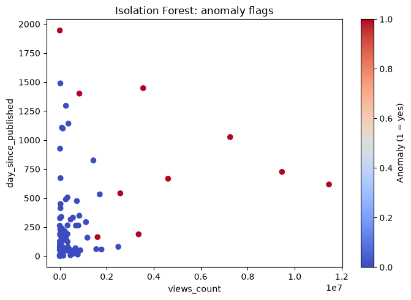

**Figure 2.** LOF anomaly flags (`views_count` × `day_since_published`)

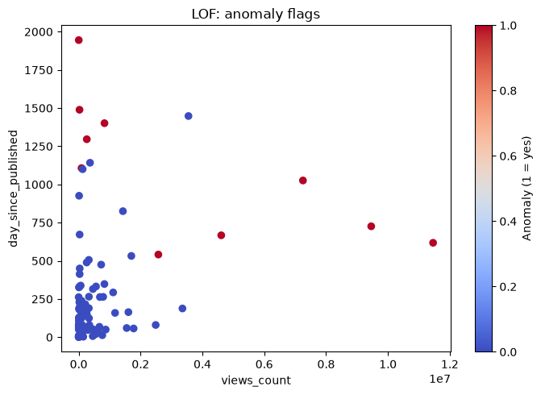

**Figure 3 (additional).** The same projection with a logarithmic `views_count` axis — on the linear axis most normal videos are compressed near zero.

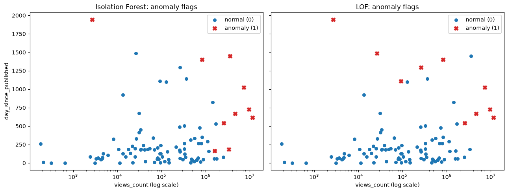

## 8. Differences Between the Algorithms

The equal number of anomalies (10 each) is not a result of the data — it is forced by `contamination=0.10`. The meaningful comparison is *which* rows were flagged.

- **Common core (7 videos).** Both algorithms agree on clearly extreme observations: viral videos with 4.6–11.5 M views (ids 1, 13, 96, 62), while the median is only ~100 K, and video 98, which is the oldest in the dataset (1945 days) but has only 2 699 views.
- **Only Isolation Forest (100, 11, 83).** Isolation Forest is a *global* method: a point is anomalous if random splits isolate it quickly, which happens when it is extreme on any single feature. Video 11 has the longest title (82 characters); videos 100 and 83 have 3.4–3.5 M views. In the 3-D space they still have a few similar neighbours, so their local density is not low enough for LOF.
- **Only LOF (67, 69, 64).** LOF is a *local*, density-based method. These videos are 1100–1500 days old with moderate views. None of their values is globally extreme, but the region of "old videos" is sparse compared to the dense cluster of recent videos, so their local density is lower than that of their neighbours (LOF ≈ 2.1–2.3).
- **ARI = 0.617** shows moderate-to-high agreement between the two partitions. Without ground truth it does not show which algorithm is more accurate.

## 9. Can `label` Serve as Verified Anomaly Ground Truth?

**No.** The `label` column was assigned manually in Lab 2 as a binary classification target and is balanced 50/50 (50 True / 50 False). Anomalies are by definition rare observations, so a label covering half of the dataset cannot mean "verified anomaly". Therefore Precision, Recall and F1 were **not** computed; the `classification_report` / `confusion_matrix` lines are left commented out as required.

For information only, 9 of the 10 Isolation Forest anomalies have `label = True`. This is not evidence of detection quality: in Lab 4 `views_count` was the dominant predictor of `label` (Random Forest importance ≈ 0.82), and most anomalies here are high-view videos, so the overlap only reflects the correlation between `label` and popularity.

## 10. Conclusions

1. Both Isolation Forest and LOF were applied to 100 videos using three standardized features; each flagged 10 videos (10%), as set by the contamination assumption.
2. The algorithms agree on 7 of 10 anomalies (ARI = 0.617). The common anomalies are viral videos with millions of views and one very old video with almost no views — these are the most reliable candidates.
3. Isolation Forest additionally flags globally extreme single values (very high views, the longest title), while LOF additionally flags old videos located in sparse regions of the feature space. Using both methods gives a more complete picture than either one alone.
4. The detected anomalies are *unusual* videos, not "bad" or "fake" ones: a viral video is a legitimate event. In a cybersecurity context the same applies — an anomaly (e.g. a spike in requests) is only a candidate for investigation, not a confirmed attack.
5. `label` cannot be used as anomaly ground truth, so the quality of detection cannot be measured numerically; results must be interpreted manually.
6. Limitations: small dataset (100 rows), the contamination value of 0.10 is an arbitrary teaching assumption, and the 2-D plots show only two of the three features (e.g. video 11 is anomalous because of `title_length`, which is invisible on the plots).

Results are saved in **`anomaly_results.csv`** (original columns + `IF_anomaly`, `IF_score`, `LOF_anomaly`, `LOF_score`).

---

## Review Questions

1. **What is an anomaly in data?** An observation that differs substantially from the typical behaviour of the rest of the data (e.g. a video with 11 M views among videos with a ~100 K median).
2. **How does anomaly detection differ from binary classification?** Classification is supervised: it learns from a labelled target and predicts known classes. Unsupervised anomaly detection needs no target; it estimates how unusual each observation is relative to the data itself.
3. **Why does an anomaly not necessarily indicate a cyberattack?** Unusual behaviour can be legitimate — a backup job at night, a marketing campaign, a viral post. An anomaly is a candidate for investigation, not proof of malicious activity.
4. **How does Isolation Forest work?** It builds many random trees that split data by a random feature at a random threshold. Anomalies are isolated after fewer splits, so their average path length is short and their anomaly score is high.
5. **How does Local Outlier Factor work?** For each point it computes the local reachability density from its k nearest neighbours and compares it to the neighbours' densities. LOF ≈ 1 means similar density (normal); LOF ≫ 1 means the point lies in a much sparser region (outlier).
6. **What do −1 and +1 mean?** In scikit-learn, −1 is an outlier (anomaly) and +1 is an inlier (normal). In this work they were converted to 1 = anomaly, 0 = normal.
7. **Why do we standardize features?** Features have very different scales (views in millions, title length in tens). Without scaling, distance-based methods like LOF would be dominated by the largest-scale feature. `z = (x − μ)/σ` gives every feature mean 0 and std 1.
8. **What does the contamination parameter mean?** The assumed proportion of anomalies; it sets the score threshold so that exactly that share of rows is flagged. It is an assumption, not a known attack rate.
9. **Why can Isolation Forest and LOF produce different results?** IF detects points that are globally easy to isolate (extreme values), LOF detects points with low density relative to their local neighbourhood. They use different definitions of "unusual" and are sensitive to different parameters (`n_estimators`, `n_neighbors`).
10. **What does the Adjusted Rand Index measure?** The similarity between two partitions, corrected for chance: 1 = identical, ≈0 = random agreement, negative = less than random. Without ground truth it measures agreement between methods, not detection quality.
11. **Can the original label be treated as verified anomaly ground truth?** Only if `label = 1` is verified to mean an anomaly. In this dataset it is a manually assigned, balanced classification target, so it cannot.
12. **What are the limitations of a two-feature visualization?** It is only a projection: features not shown (here `title_length`) can be the reason a point is anomalous, so some anomalies look normal and some normal points may look suspicious. Interactions in higher dimensions are hidden, and skewed scales can hide structure (hence the additional log-scale plot).
