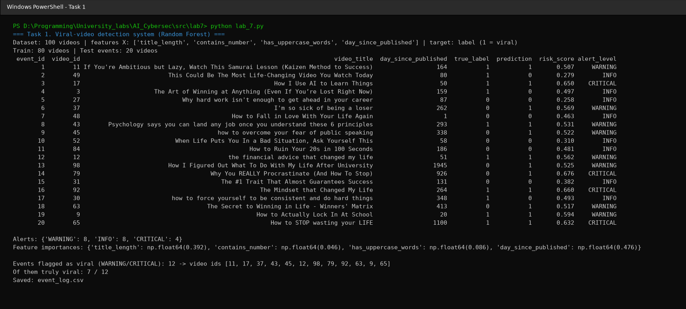
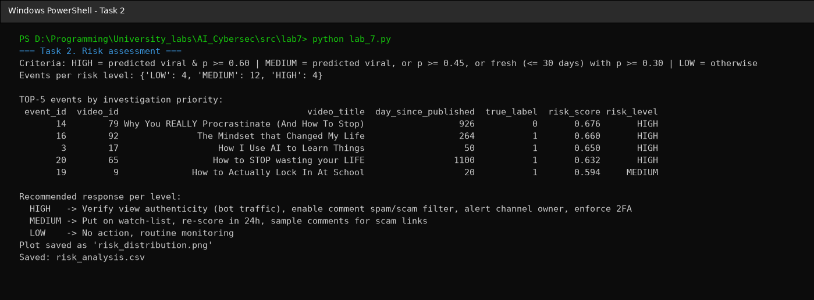
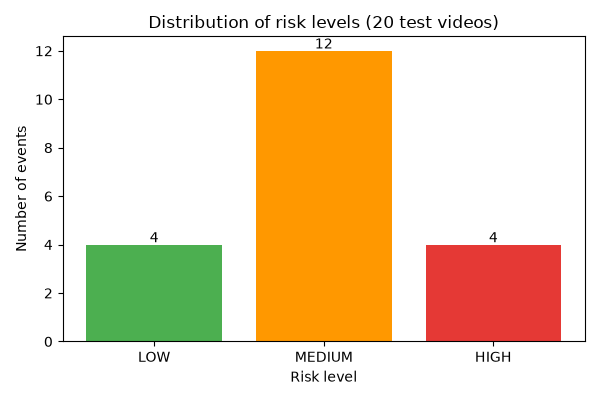
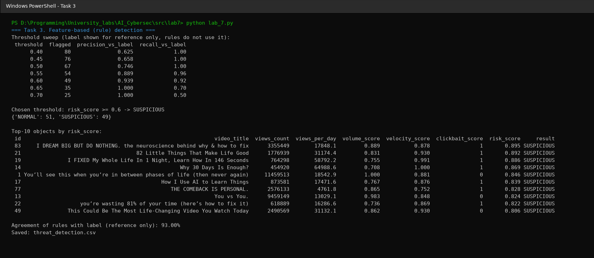
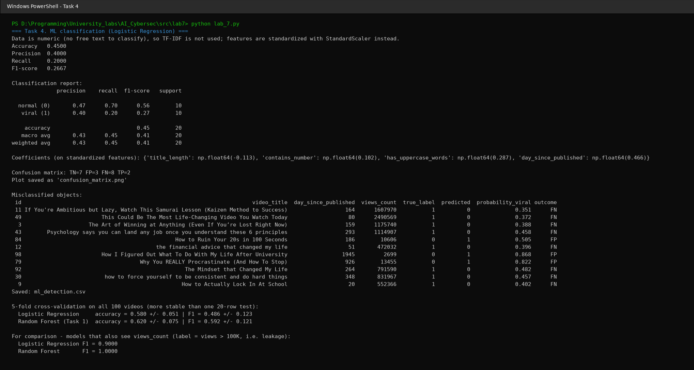
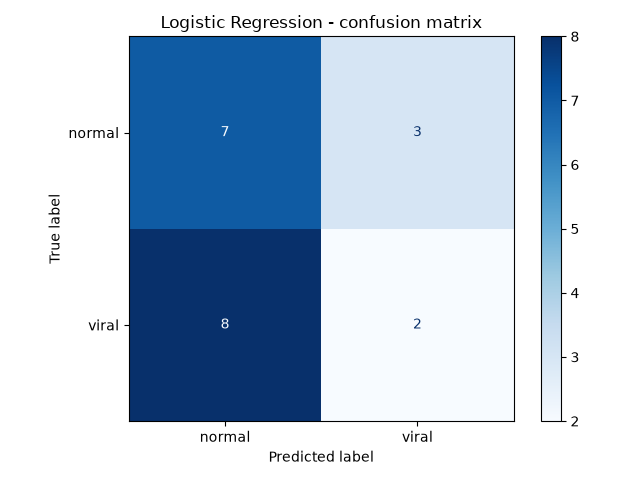

# Laboratory Work No. 7: Development of Intelligent Cyber Threat Detection and Analysis Systems Using Machine Learning

**Course:** Artificial Intelligence in Cybersecurity  
**Student:** `<STUDENT_NAME>`  
**Group:** `<GROUP>`  
**Date:** `<DATE>`  
**Individual variant:** `<VARIANT_NUMBER>`: self-improvement YouTube videos, detection of viral (abnormal-popularity) videos (dataset from Labs 2–3)

---

## 1. Objective

To develop an intelligent system that detects, classifies and assesses the risk of **viral (abnormal-popularity) videos** with machine learning and rule-based methods on the individual dataset. The work covers an IDS-style detector with alert levels, risk prioritisation, feature-based (rule) detection and ML classification with quality evaluation.

**Threat model for the variant.** A sudden spike in a video's popularity is treated as a security-relevant event. When a video goes viral, it and its channel become a target for:

- view-botting and fake engagement (are the views real?);
- scam and spam comment bots (phishing / crypto-scam links in comments);
- impersonating channels re-uploading the video with fake "giveaways";
- channel account-takeover attempts.

So the positive class `label = 1` (viral) plays the role of a "suspicious event" in the lab's examples.

## 2. Dataset Description and Selected Features

`clean_dataset.csv`: 100 videos × 9 columns, no missing values, balanced target (50 viral / 50 normal).

| Column | Type | Meaning | Used in |
|---|---|---|---|
| `title_length` | int | Characters in the title | Tasks 1, 4 |
| `contains_number` | bool→0/1 | Title contains a digit | Tasks 1, 3, 4 |
| `has_uppercase_words` | bool→0/1 | Title has fully UPPERCASE words | Tasks 1, 3, 4 |
| `day_since_published` | int | Age of the video in days | Tasks 1, 4 |
| `views_count` | int | Number of views | Task 3 only |
| `views_per_day` | float (derived) | `views_count / day_since_published` | Task 3 only |
| `label` | bool→0/1 | **Target**: 1 = viral, 0 = normal | target |

**Data leakage check.** `label` is exactly `views_count > 100 000` (max views among normal videos = 95 547, min among viral = 104 585). A model that sees `views_count` re-learns this threshold and reaches F1 = 1.00 (Random Forest) / 0.90 (Logistic Regression), as shown at the end of Task 4. That is leakage, not detection. So the ML detectors (Tasks 1 and 4) use only the **pre-view signals**: `title_length`, `contains_number`, `has_uppercase_words`, `day_since_published`. The system becomes an *early-warning* detector. The rule-based detector (Task 3) inspects observed activity (views), just as an IDS inspects traffic volume.

Train/test split for Tasks 1 and 4: 80 / 20 videos, stratified (`random_state = 42`). The 20 test videos are the "new events".

Full source code: `lab_7.py` / `Lab7_Code.ipynb`. Execution screenshots: `screenshots/`.

---

## 3. Task 1: Intelligent Detection System

### Source code
```python
ML_FEATURES = ["title_length", "contains_number", "has_uppercase_words", "day_since_published"]
train_df, test_df = train_test_split(df, test_size=0.20, random_state=42, stratify=df["label"])

rf = RandomForestClassifier(n_estimators=200, max_depth=4, min_samples_leaf=2, random_state=42)
rf.fit(train_df[ML_FEATURES], train_df["label"])

predictions = rf.predict(test_df[ML_FEATURES])
probabilities = rf.predict_proba(test_df[ML_FEATURES])[:, 1]

CRITICAL_THRESHOLD = 0.60
def alert_level(prediction, probability):
    if prediction == 0:
        return "INFO"
    if probability >= CRITICAL_THRESHOLD:
        return "CRITICAL"
    return "WARNING"

event_log["alert_level"] = [alert_level(p, s) for p, s in zip(predictions, probabilities)]
event_log.to_csv("event_log.csv", index=False)
```



### Results (`event_log.csv`)

| event | video id | title (short) | days | true | pred | risk_score | alert |
|---|---|---|---|---|---|---|---|
| 1 | 11 | If You're Ambitious but Lazy… Samurai Lesson | 164 | 1 | 1 | 0.507 | WARNING |
| 2 | 49 | This Could Be The Most Life-Changing Video… | 80 | 1 | 0 | 0.279 | INFO |
| 3 | 17 | How I Use AI to Learn Things | 50 | 1 | 1 | 0.650 | CRITICAL |
| 4 | 3 | The Art of Winning at Anything… | 159 | 1 | 0 | 0.497 | INFO |
| 5 | 27 | Why hard work isn't enough… | 87 | 0 | 0 | 0.258 | INFO |
| 6 | 37 | I'm so sick of being a loser | 262 | 0 | 1 | 0.569 | WARNING |
| 7 | 48 | How to Fall in Love With Your Life Again | 1 | 0 | 0 | 0.463 | INFO |
| 8 | 43 | Psychology says you can land any job… | 293 | 1 | 1 | 0.531 | WARNING |
| 9 | 45 | how to overcome your fear of public speaking | 338 | 0 | 1 | 0.522 | WARNING |
| 10 | 52 | When Life Puts You In a Bad Situation… | 58 | 0 | 0 | 0.310 | INFO |
| 11 | 84 | How to Ruin Your 20s in 100 Seconds | 186 | 0 | 0 | 0.481 | INFO |
| 12 | 12 | the financial advice that changed my life | 51 | 1 | 1 | 0.562 | WARNING |
| 13 | 98 | How I Figured Out What To Do With My Life… | 1945 | 0 | 1 | 0.525 | WARNING |
| 14 | 79 | Why You REALLY Procrastinate… | 926 | 0 | 1 | 0.676 | CRITICAL |
| 15 | 31 | The #1 Trait That Almost Guarantees Success | 131 | 0 | 0 | 0.382 | INFO |
| 16 | 92 | The Mindset that Changed My Life | 264 | 1 | 1 | 0.660 | CRITICAL |
| 17 | 30 | how to force yourself to be consistent… | 348 | 1 | 0 | 0.493 | INFO |
| 18 | 63 | The Secret to Winning in Life… | 413 | 0 | 1 | 0.517 | WARNING |
| 19 | 9 | How to Actually Lock In At School | 20 | 1 | 1 | 0.594 | WARNING |
| 20 | 65 | How to STOP wasting your LIFE | 1100 | 1 | 1 | 0.632 | CRITICAL |

**Alerts:** CRITICAL 4, WARNING 8, INFO 8.  
**Feature importances:** `day_since_published` 0.476, `title_length` 0.392, `has_uppercase_words` 0.086, `contains_number` 0.046.

**Justification of the CRITICAL threshold.** The example uses 0.85, but with weak pre-view features the forest never becomes that confident: probabilities range from 0.26 to 0.68. A threshold of 0.60 marks predictions that are clearly on the "viral" side of 0.5.

### Which events were identified as suspicious

12 of 20 events were flagged as viral (WARNING / CRITICAL): video ids 11, 17, 37, 43, 45, 12, 98, 79, 92, 63, 9, 65.

- **7 are truly viral** (11, 17, 43, 12, 92, 9, 65), so precision ≈ 0.58 and 7 of 10 viral videos were caught (recall 0.70).
- 3 of the 4 CRITICAL alerts are correct (17, 92, 65). The false CRITICAL is id 79: an old video (926 days) with a CAPS word in the title. The model learned that older videos and CAPS words go with virality.
- Missed viral videos (INFO): ids 49, 3, 30.

`<YOUR_COMMENT: which alerts you find most convincing and why>`

---

## 4. Task 2: Risk Level Assessment

### Source code
```python
risk = pd.read_csv("event_log.csv")

def assess_risk(row):
    p = row["risk_score"]
    if row["prediction"] == 1 and p >= 0.60:
        return "HIGH"
    if row["prediction"] == 1 or p >= 0.45:
        return "MEDIUM"
    if row["day_since_published"] <= 30 and p >= 0.30:
        return "MEDIUM"
    return "LOW"

risk["risk_level"] = risk.apply(assess_risk, axis=1)
risk["response"] = risk["risk_level"].map(RESPONSE)
top5 = risk.sort_values(["_level_rank", "risk_score", "day_since_published"],
                        ascending=[False, False, True]).head(5)
risk.to_csv("risk_analysis.csv", index=False)
```



### Risk criteria and justification

| Level | Criterion | Justification |
|---|---|---|
| HIGH | predicted viral **and** p ≥ 0.60 | Strongest evidence the model can give; same as a CRITICAL alert |
| MEDIUM | predicted viral, **or** p ≥ 0.45, **or** (≤ 30 days old **and** p ≥ 0.30) | Borderline cases close to 0.5 must not be dropped. Fresh videos are where a spike is still forming, so they get a lower bar |
| LOW | otherwise | Model is fairly confident the video is ordinary |

### Risk table

| Risk level | Number of events |
|---|---|
| HIGH | 4 |
| MEDIUM | 12 |
| LOW | 4 |



### TOP-5 events by investigation priority

Sorted by risk level, then risk_score, then fresher video first.

| # | event | video id | title | days | true label | risk_score | level |
|---|---|---|---|---|---|---|---|
| 1 | 14 | 79 | Why You REALLY Procrastinate (And How To Stop) | 926 | 0 | 0.676 | HIGH |
| 2 | 16 | 92 | The Mindset that Changed My Life | 264 | 1 | 0.660 | HIGH |
| 3 | 3 | 17 | How I Use AI to Learn Things | 50 | 1 | 0.650 | HIGH |
| 4 | 20 | 65 | How to STOP wasting your LIFE | 1100 | 1 | 0.632 | HIGH |
| 5 | 19 | 9 | How to Actually Lock In At School | 20 | 1 | 0.594 | MEDIUM |

### Response measures

| Level | Response |
|---|---|
| HIGH | Verify view authenticity (bot-traffic analysis), enable stricter comment spam/scam filtering, notify the channel owner, enforce 2FA on the channel account |
| MEDIUM | Add to watch-list, re-score within 24 h, sample comments for scam/phishing links |
| LOW | No action, routine monitoring |

### Conclusions for Task 2

`<YOUR_CONCLUSION>` Suggested points: 4 of 5 TOP-5 events are truly viral. Most events (12) end up in MEDIUM because the model's probabilities cluster around 0.5. The risk scale is driven by a weak model, so in practice MEDIUM should mean "verify", not "act".

---

## 5. Task 3: Feature-Based (Rule) Detection

### Source code
```python
def log_minmax(series):
    s = np.log1p(series)
    return (s - s.min()) / (s.max() - s.min())

threat["volume_score"]    = log_minmax(threat["views_count"])
threat["velocity_score"]  = log_minmax(threat["views_per_day"])
threat["clickbait_score"] = ((threat["contains_number"] + threat["has_uppercase_words"]) > 0).astype(int)

threat["risk_score"] = (0.45 * threat["volume_score"]
                        + 0.45 * threat["velocity_score"]
                        + 0.10 * threat["clickbait_score"])

threat["result"] = np.where(threat["risk_score"] >= 0.60, "SUSPICIOUS", "NORMAL")
threat.to_csv("threat_detection.csv", index=False)
```



### Selected features and why they may indicate a threat

| Indicator | Feature | Why it signals a threat | IDS analogy |
|---|---|---|---|
| Volume | `views_count` | Very large view totals make a video a target for scam comments, re-uploads and account theft; they may also be inflated by bots | traffic volume |
| Velocity | `views_per_day` | A sharp growth rate is the classic sign of a spike, organic or bot-driven | requests per second |
| Lure | clickbait title (`contains_number` or `has_uppercase_words`) | Numbers and CAPS are engagement bait, the same psychological lever used in phishing subjects | phishing lure |

### Scaling and rules

- Views range from 182 to 11.4 M, so `log1p` is applied first and then min-max scaling to [0, 1]. Without the log, one mega-viral video would push all other scores to ≈ 0.
- Weights 0.45 / 0.45 / 0.10: activity indicators dominate; the title is only a weak hint (confirmed by Task 1, where title-style features had low importance).

### Threshold selection

| threshold | flagged | precision vs label | recall vs label |
|---|---|---|---|
| 0.40 | 80 | 0.625 | 1.00 |
| 0.50 | 67 | 0.746 | 1.00 |
| 0.55 | 54 | 0.889 | 0.96 |
| **0.60** | **49** | **0.939** | **0.92** |
| 0.65 | 35 | 1.000 | 0.70 |
| 0.70 | 25 | 1.000 | 0.50 |

**0.60** was chosen: it is the highest threshold that still catches more than 90% of viral videos. 0.65 would miss 30% of them, and lower thresholds flag up to 80% of all videos (alert fatigue). `label` was used only as a reference to justify the threshold; the rule itself does not read it.

### Results

- **SUSPICIOUS: 49**, NORMAL: 51
- Agreement with `label` (reference only): **93%**. This is high because the rule uses views and the label is defined by views.
- Highest-scoring objects: ids 83 (3.4 M views, CAPS title), 21 ("82 Little Things…", 31 K views/day), 19 ("I FIXED My Whole Life In 1 Night…", 58.8 K views/day), 14 (65 K views/day).

`<YOUR_COMMENT>`

---

## 6. Task 4: ML Classification

### Source code
```python
X_train, y_train = train_df[ML_FEATURES], train_df["label"]
X_test,  y_test  = test_df[ML_FEATURES],  test_df["label"]

lr = make_pipeline(StandardScaler(), LogisticRegression(max_iter=1000, random_state=42))
lr.fit(X_train, y_train)
y_pred = lr.predict(X_test)

accuracy_score(y_test, y_pred); precision_score(y_test, y_pred)
recall_score(y_test, y_pred);   f1_score(y_test, y_pred)
cm = confusion_matrix(y_test, y_pred, labels=[0, 1])
ml.to_csv("ml_detection.csv", index=False)
```

**Feature preparation:** the dataset has no free text to classify (titles are already summarised as numeric features), so **TF-IDF is not used**. Numeric features are standardised with `StandardScaler`, fitted on the training set only (inside the pipeline).



### Metrics (20 test videos, not used in training)

| Accuracy | Precision | Recall | F1-score |
|---|---|---|---|
| 0.4500 | 0.4000 | 0.2000 | 0.2667 |

5-fold cross-validation on all 100 videos (more stable estimate):

| Model | Accuracy | F1-score |
|---|---|---|
| Logistic Regression | 0.580 ± 0.051 | 0.486 ± 0.123 |
| Random Forest (Task 1) | 0.620 ± 0.075 | 0.592 ± 0.121 |

Leakage comparison (same split, models that also see `views_count`): LR F1 = 0.90, RF F1 = 1.00.

### Confusion matrix

|  | Predicted normal | Predicted viral |
|---|---|---|
| **Actual normal** | TN = 7 | FP = 3 |
| **Actual viral** | FN = 8 | TP = 2 |



### Error analysis and consequences for information security

- **False negatives (8):** viral videos classified as normal: ids 11, 49, 3, 43, 12, 92, 30, 9. Several have 0.5–2.5 M views. *Consequence:* the threat goes unnoticed. No bot-traffic check is done, scam comments spread without stricter filters, and the channel owner is not warned about takeover risk. In security, a missed attack is usually the more costly error.
- **False positives (3):** ids 84, 98, 79, normal videos flagged as viral. Id 98 is the oldest video (1945 days) with only 2.7 K views; the model over-trusts "old ⇒ viral". *Consequence:* wasted analyst time and alert fatigue. Too many false alarms train analysts to ignore alerts.
- **Why the errors happen:** the pre-view features carry only a weak signal (CV accuracy 0.58–0.62 vs 0.50 for random guessing), and the test set is tiny (one video = 5% accuracy). Logistic Regression can only draw one linear boundary, while Random Forest captures interactions and performs better.

`<YOUR_COMMENT>`

---

## 7. Analysis of Detected Threats

`<YOUR_ANALYSIS>` Suggested structure:

1. **What was detected.** The rule-based detector reliably flags viral videos once views are observed (93% agreement). The ML early-warning detectors work only slightly better than chance before views are known.
2. **Most reliable threats.** Videos flagged by both approaches, e.g. ids 17, 92, 65 (CRITICAL in Task 1 and SUSPICIOUS in Task 3).
3. **Rule-based vs ML.** Rules are transparent and strong when the right indicator (views) is available, but their thresholds are hand-picked. ML learns its boundary from data, but here it has only weak signals, and it becomes trivial (leakage) when given the answer-defining feature.
4. **Typical false alarm.** Old videos with clickbait-style titles (ids 79, 98).

## 8. Conclusions

`<YOUR_CONCLUSIONS>` Suggested points:

1. An IDS-style pipeline (detect → alert → prioritise → respond) was built for the individual variant, with viral videos treated as abnormal-popularity security events.
2. The target `label` is a threshold on `views_count`. Using that feature gives a perfect but meaningless model (leakage), so the ML detectors were restricted to pre-view features.
3. Random Forest flagged 12 of 20 test videos (precision 0.58, recall 0.70); CV accuracy is 0.62. Logistic Regression was weaker (CV accuracy 0.58; F1 = 0.27 on the given split, with 8 missed viral videos).
4. The rule-based detector, using log-scaled volume, velocity and clickbait indicators with a justified threshold of 0.60, flagged 49 videos with 93% agreement with the label.
5. Risk prioritisation turned the model's output into 4 HIGH / 12 MEDIUM / 4 LOW events with a response playbook. Thresholds had to be adapted to the actual range of model probabilities.
6. Limitations: only 100 videos, a 20-row test set, weak pre-view features, and thresholds chosen by hand. Real early detection would need early-activity data (e.g. views in the first hours, likes and comments rate).

## Files Submitted

- `Lab7_Report.pdf`: this report
- `Lab7_Code.ipynb`: source code with outputs
- `event_log.csv`, `risk_analysis.csv`, `threat_detection.csv`, `ml_detection.csv`

---

## Control Questions

1. **What is an intelligent intrusion detection system (IDS)?** A system that monitors events (network traffic, logs, user activity) and uses ML or rules to automatically flag suspicious activity and raise alerts. "Intelligent" means it learns patterns from data instead of relying only on fixed signatures.
2. **Which ML algorithms are used for cyber threat detection?** Supervised: Decision Tree, Random Forest, SVM, Logistic Regression, KNN, gradient boosting, neural networks. Unsupervised: Isolation Forest, LOF, k-means / DBSCAN for anomaly detection.
3. **Rule-based vs ML-based detection?** Rule-based detection uses hand-written conditions and thresholds (transparent, needs no training data, but misses new patterns and needs manual tuning). ML-based detection learns the decision boundary from labelled or unlabelled data (adapts and finds complex patterns, but needs data and is harder to interpret).
4. **Which features may indicate Malware/Ransomware?** Mass file modification or renaming, high-entropy (encrypted) writes, deletion of backups / shadow copies, unusual process spawning, privilege escalation, contact with C2 servers, sudden CPU / disk spikes.
5. **How is the risk level of an event determined?** By combining the model's confidence (probability / risk score) with context (asset value, freshness, impact) and mapping it to levels (LOW / MEDIUM / HIGH) using justified thresholds.
6. **What are phishing and spam?** Phishing: fraudulent messages that impersonate a trusted party to steal credentials, money or data. Spam: unsolicited bulk messages, often advertising, sometimes carrying malware or phishing links.
7. **What is the purpose of TF-IDF?** It converts text into numeric vectors. Each word is weighted by how often it appears in a document (TF), reduced by how common it is across all documents (IDF), so distinctive words get high weights.
8. **When is TF-IDF not required?** When the data is already numeric or categorical (as in this work: lengths, counts, flags, ages), or when no text field is being classified.
9. **Precision vs Recall vs F1?** Precision = TP / (TP + FP): how many alerts were real. Recall = TP / (TP + FN): how many real threats were caught. F1 = harmonic mean of the two; it is high only when both are high.
10. **Why are FP and FN important in cybersecurity?** A false negative is a missed attack, which can cause real damage. False positives waste analyst time and cause alert fatigue, so real alerts start being ignored. Systems must balance the two according to the cost of each error.
